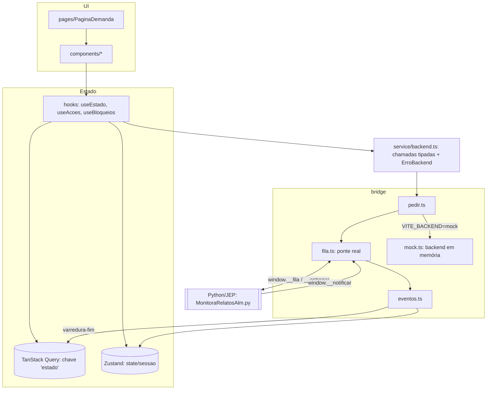

# Arquitetura da SPA

Complemento de `vsrun/.../architecture.md` (visão do sistema inteiro) e de
`vsrun/.../frontend-integration.md` (contrato). Aqui fica só o lado React.

## 1. Camadas

| Camada | Arquivos | Responsabilidade | Não faz |
|--------|----------|------------------|---------|
| Contrato | `src/@types/backend.ts` | Tipos de payload, respostas e eventos, espelhando `frontend-integration.md` | Lógica |
| Bridge | `src/bridge/` | Fila serial, sinal ao Python, reenvio, eventos e mock | Conhecer telas |
| Service | `src/service/backend.ts` | Uma função por ação. `ok:false` vira `ErroBackend` (com `codigo` e o `estado` opcional) | Toast, cache |
| Estado servidor | `src/hooks/useEstado.ts`, `src/lib/queryClient.ts` | A query `['estado']` guarda o envelope (demandas, relatos, ultimaPersistencia) | Refetch automático |
| Mutações | `src/hooks/useAcoes.ts` | Chamada → `definirEstado` com o envelope da resposta → toast. Erros vão para `aoErrar` | Estado de UI local |
| Estado de UI | `src/state/sessao.ts` | Fase, persona, sessão expirada, progresso da varredura, encerrado | Dados de relatos |
| Bloqueios | `src/hooks/useBloqueios.ts` | Deriva o que pode ser clicado a partir de fase, mutações e varredura | — |
| UI | `src/pages`, `src/components` | Apresentação com `nfse-ds` + Tailwind | Chamar `pedir` direto |

## 2. Ciclo de um pedido

1. O componente chama uma mutação (`useCadastrar().mutate(...)`).
2. `backend.cadastrarRelatos` → `pedir({acao, ...})`.
3. `fila.ts` (`pedirReal`) espera a resposta do pedido anterior (`cauda`), faz o push em `window.__fila` e
   chama `transferirControleParaScript()`. Se o item continuar na fila, repete o sinal a cada 1,5 s.
4. O Python faz o shift, executa e chama `window.__entregar(id, json)`, e a Promise resolve.
5. `chamar()` lança `ErroBackend` se `ok:false`. Senão, a mutação aplica o envelope com
   `setQueryData` (sem refetch) e mostra o toast.

Invariantes (quebrá-las derruba o script ou trava a tela):

- **Nunca** chamar `transferirControleParaScript` com a fila vazia: na fase ociosa o Python lê isso como X.
- **Um pedido por vez**. Só `fechar` fura a fila, porque é ele que interrompe a varredura em curso.
- Os globais (`__fila`, `__resp`, `__seq`, `__entregar`, `__notificar`) são instalados em `App.tsx`
  **antes** do primeiro render (`instalarFila()`).

## 3. Eventos Python → SPA

`window.__notificar(json)` → `emitirEvento` → ouvinte em `useBoot` (`App.tsx`):

| Evento | Efeito |
|--------|--------|
| `fase` | `useSessao.aplicarEvento`: fase, autenticado e limpeza de `sessaoCaiu` ao autenticar |
| `status` | Texto do painel de autenticação |
| `varredura` | Progresso `{atual, total, numeroAlm}`, que liga o bloqueio |
| `varredura-fim` | Limpa o progresso e o **estado inteiro** vai para a query (`definirEstado`) |
| `sessao-caiu` | Banner de reautenticação e ações ALM desabilitadas |

## 4. Boot

1. `instalarFila()` no carregamento do módulo `App.tsx`.
2. `status_sessao` preenche fase, persona, versão e `varreduraAoAbrir` (`carregado = true`).
3. `useEstado` habilita a query `carregar_estado` (fora da auth). `ocupado-*` é repetido a cada 1,5 s,
   até 10 vezes, por causa da varredura ao abrir.
4. `HashRouter` → `PaginaDemanda` redireciona para a primeira demanda.

## 5. Decisões de build e runtime

| Decisão | Motivo |
|---------|--------|
| `HashRouter` | A SPA roda de `file://` (blob extraído), onde não há servidor para reescrever rotas |
| Vite `base: './'` | Assets relativos ao `index.html` extraído numa pasta temporária |
| Portas 5174/4174 `strictPort` | O script abre exatamente essas URLs. 5173/4173 são do Painel NFSe |
| `resolve.dedupe` react/react-dom | O `nfse-ds` vem por `file:` e traz o próprio React |
| Alias `nfse-ds/componentes.css` → `dist/index.css` | O CSS não está em `exports` do pacote |
| TanStack Table **v9** | `useTable`, `tableFeatures` e `table.FlexRender`. A API v8 não funciona |
| Vitest `pool: threads` | Com forks, a inicialização estoura o tempo limite nesta estação (antivírus) |
| `staleTime: Infinity`, sem retry | O backend só muda por ação da SPA ou por evento |

## 6. Como estender (P5+)

- **Ação nova:** `frontend-integration.md` → `Payload` + tipo de resposta → `mock.ts` + teste →
  `backend.ts` → hook em `useAcoes.ts` (reusar `aplicar`/`aoErrar`) → UI → mensagem de erro nova
  em `mensagens.ts`.
- **Ação que não muda estado** (ex.: `abrir_no_alm`): mutação sem `definirEstado`.
- **Campo novo em Relato/Demanda:** o tipo aceita opcional/`null` (um JSON antigo não traz o campo) e o mock
  preenche o valor.
- **Regra de negócio** (categoria de status, limites de texto) fica no STORE. A SPA replica só
  o necessário para validar antes de enviar, com um teste de paridade (como em `numeros.test.ts`).
